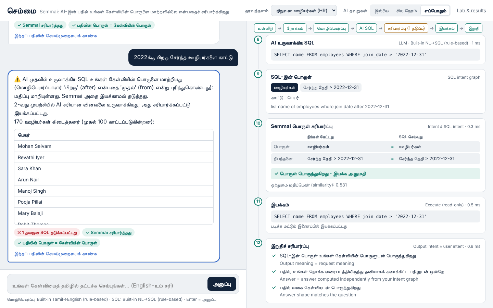
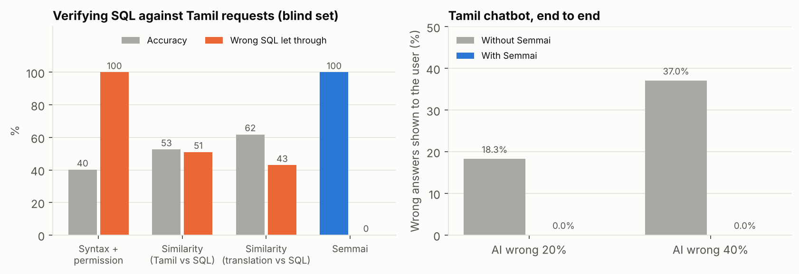
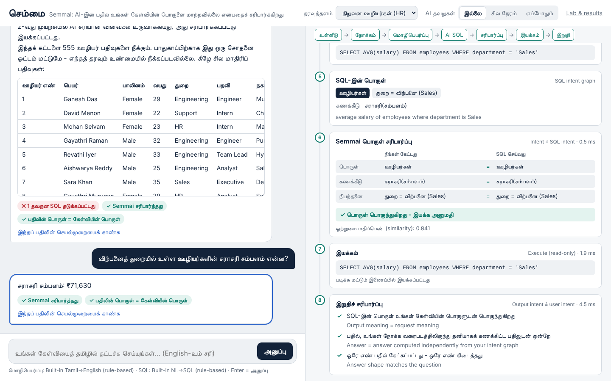
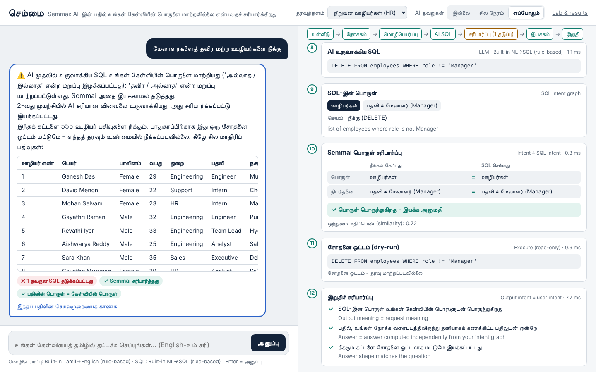
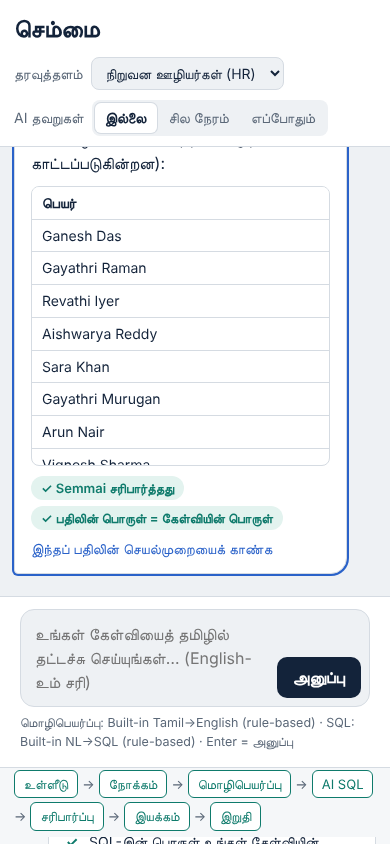
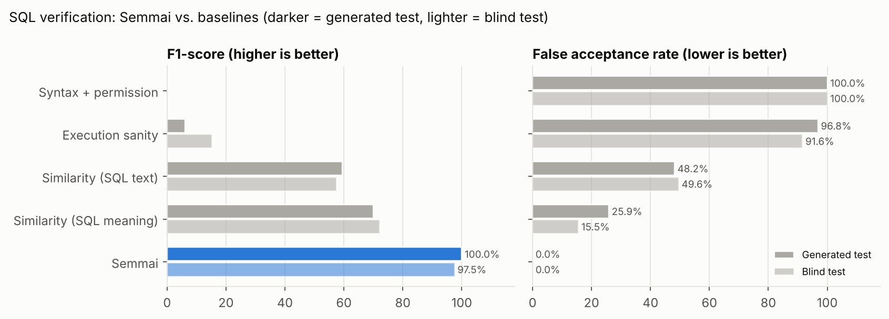
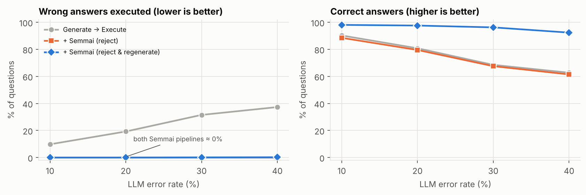
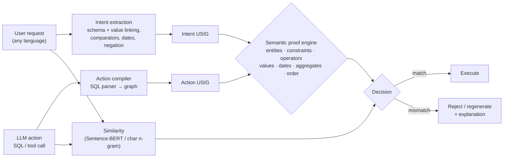

# Semmai (செம்மை): Semantic Verification for Tamil LLM Agents

> *"Correct syntax does not always mean correct intent."*

Ask a database a question **in Tamil**. An AI translates it and writes SQL, but before that SQL
runs, **Semmai checks that it still means what you asked**. If a tiny word was lost (*பிறகு* "after"
became "from", *தவிர* "except" disappeared), the query is **blocked**, the AI is asked to try again,
and only a meaning-preserving query is executed.



| நீங்கள் கேட்பது (You ask) | AI generates | Syntax check | Semmai |
|---|---|---|---|
| 2022க்கு **பிறகு** சேர்ந்த ஊழியர்களை காட்டு | `WHERE join_date >= '2022-01-01'` | ✅ valid | ⛔ **"after 2022" became "from 2022"** (234 rows instead of 170) |
| பயிற்சியாளர்களைத் **தவிர** மற்ற ஊழியர்களைக் காட்டு | `SELECT name FROM employees` | ✅ valid | ⛔ **"except interns" was dropped** |
| மேலாளர்களைத் **தவிர** மற்ற ஊழியர்களை **நீக்கு** | `DELETE FROM employees` | ✅ valid | ⛔ **would delete the managers too** |
| Show patients **older than 60** | `WHERE age >= 60` | ✅ valid | ⛔ **operator changed: > 60 vs ≥ 60** |

**Semmai** compiles both the request and the generated action into a language-independent
**Universal Semantic Intent Graph (USIG)**, the "skeleton of meaning", proves that the two graphs
are equivalent, and only then lets the action run.

```
Without Semmai:  Tamil ──► Translate ──► SQL ──► Execute
With Semmai:     Tamil ──► Meaning ──► Translate ──► SQL ──► Meaning again ──► Compare ──► Execute | Block (→ regenerate)
```

## Tamil results

From [`results/tamil_results.md`](results/tamil_results.md) (`python scripts/evaluate_tamil.py`):

| What was measured | Result |
|---|---|
| Understanding Tamil requests: **blind test**, written and frozen in git before the Tamil parser existed (first run) | **98.0%** exact meaning (49/50) |
| Verifying SQL against Tamil requests (blind set, 249 SQL candidates) | Semmai **100% accuracy, 0% wrong SQL let through**. Syntax check: 0% F1. Similarity: 55-64% F1 |
| Realistic translation mistakes (after→from, dropped "except", number/year changes, ...): 223 cases | **100% caught**; 96% of them would otherwise have *silently* returned a wrong answer |
| Tamil chatbot end to end, AI wrong 20% / 40% of the time | wrong answers shown to the user: **18.3% → 0%** / **37.0% → 0%** |



## Run it on your computer (no Anaconda, no pip installs)

The chatbot needs **only Python 3.9 or newer**: the web server, the database, the Tamil parser,
the verifier and the multilingual model all use the Python standard library.

**Windows**

1. If you don't have Python yet: download it from <https://www.python.org/downloads/>, run the
   installer and tick **"Add python.exe to PATH"** (or run `winget install Python.Python.3.12`).
2. Download this repository (green **Code** button → **Download ZIP**) and unzip it.
3. Double-click **`start_demo.bat`** and keep the black window open. Your browser opens
   **http://localhost:8000**, the Tamil chatbot. The verifier and all result tables are at
   **http://localhost:8000/lab**.

**macOS / Linux:** `./start_demo.sh` (or `python3 app/server.py`).

In the chatbot, the **"AI தவறுகள்" (AI mistakes)** switch makes the translator / LLM make
realistic mistakes (*சில நேரம்* = about half the time, *எப்போதும்* = always on the first attempt), so you can
watch Semmai catch them in the pipeline panel.

| Answer with verified pipeline | Delete is blocked, then run as a dry run | Phone |
|---|---|---|
|  |  |  |

### Using real models (optional)

The default translator and SQL generator are built in, so everything works offline. To plug in real models:

| Component | How |
|---|---|
| **IndicTrans2** Tamil→English translator ([ai4bharat](https://huggingface.co/ai4bharat/indictrans2-indic-en-1B)) | `pip install torch "transformers<5" IndicTransToolkit`, accept the model licence on Hugging Face, then `set SEMMAI_TRANSLATOR=indictrans2` (optional: `set SEMMAI_IT2_MODEL=ai4bharat/indictrans2-indic-en-1B`; the default is the lighter `...-dist-200M`) |
| **Qwen2.5-Coder** via [Ollama](https://ollama.com) | `ollama pull qwen2.5-coder:7b`, then `set SEMMAI_LLM=ollama` |
| Any OpenAI-compatible API (OpenAI, Groq, Gemini, ...) | `set SEMMAI_LLM=openai`, `SEMMAI_LLM_BASE_URL=...`, `SEMMAI_LLM_API_KEY=...`, `SEMMAI_LLM_MODEL=...` |

Start the demo from the same terminal afterwards (`python app\server.py`). Semmai's own Tamil
understanding is independent of these models, which is what lets it catch their mistakes.

Command line (also no installs needed):

```bash
python -m semmai verify --db hospital "Show patients older than 60" "SELECT name FROM patients WHERE age >= 60"
#  Decision : REJECT
#  SQL means: list name of patients where age at least 60
#  [critical] OPERATOR_MISMATCH: boundary/operator changed: expected 'age more than 60', got 'age at least 60'

python -m semmai intent --db travel "Flights from Chennai to Delhi under 5000"
```

**Re-running the experiments** (rebuilds data, results, figures; ~1 minute) needs the scientific
packages: `pip install -r requirements.txt`, then `run_all.bat` (Windows) or `./run_all.sh`.
The older Streamlit demo is still available: `streamlit run app/streamlit_app.py`.

Use it from Python:

```python
from semmai.schema import Schema
from semmai.verifier import SemmaiVerifier

schema = Schema("shop", "path/to/any.sqlite")          # any SQLite database
verdict = SemmaiVerifier(schema).verify(question, generated_sql)
if verdict.allowed:
    run(generated_sql)
else:
    print([f.message for f in verdict.findings])        # explanations to send back to the LLM
```

**Real LLM (Qwen2.5-Coder):** install [Ollama](https://ollama.com), `ollama pull qwen2.5-coder:7b`,
then `python scripts/run_pipeline_experiment.py --ollama qwen2.5-coder:7b`.
**Sentence-BERT:** `pip install sentence-transformers` - the similarity module switches to
`paraphrase-multilingual-MiniLM-L12-v2` automatically (otherwise it uses a character n-gram
fallback that needs no download; the reported numbers use this fallback).

## English SQL and multilingual tool-call results

All numbers below are produced by the scripts in this repository (`./run_all.sh`).

**SQL verification** - blind test set (80 questions written and frozen in git *before* the
system was run on them; 398 correct/incorrect SQL candidates):

| Method | Accuracy | F1 | False acceptance ↓ | False rejection ↓ |
|---|---|---|---|---|
| Syntax + permission check (status quo) | 40.2% | 0.0% | 100.0% | 0.0% |
| Execution sanity (query returns rows) | 44.2% | 15.3% | 91.6% | 2.5% |
| Semantic similarity (question vs. SQL meaning) | 61.1% | 72.2% | 15.5% | 73.8% |
| **Semmai** | **97.0%** | **97.5%** | **0.0%** | 7.5% |
| *Execution-match oracle (needs the gold answer)* | *96.2%* | *96.7%* | *6.3%* | *0.0%* |

On the larger generated test split (1,319 candidates) and the hand-written set (300) Semmai
reaches 100% accuracy. It even beats an oracle that compares results against the *correct*
query's results, because 6-8% of semantic errors return exactly the same rows on the current
data (e.g. `>= 60` vs `> 60` when nobody is exactly 60) and so are invisible to execution checks.

**Multilingual tool actions** (MASSIVE format, 6 languages incl. Tamil & Hindi, held-out
templates, 2,812 candidates): Semmai **93.9% accuracy / 93.8% F1** vs. 49.9% F1 for similarity.

**End-to-end agent** (LLM wrong 20% of the time): correct answers rise from **80.8% → 97.6%**
and silently wrong answers fall from **19.2% → 0.0%** with Semmai + regeneration.

| Project target (slides) | Result (SQL, blind set) | Result (tools, 6 languages) |
|---|---|---|
| Verification accuracy ≥ 90% | **97.0%** ✅ | **93.9%** ✅ |
| F1-score ≥ 90% | **97.5%** ✅ | **93.8%** ✅ |
| False acceptance rate ≤ 5% | **0.0%** ✅ | 7.8% ✗ (see report §7) |




Full tables: [`results/sql_results.md`](results/sql_results.md) ·
[`results/tools_results.md`](results/tools_results.md) ·
[`results/pipeline_results.md`](results/pipeline_results.md) ·
**Project report: [`docs/REPORT.md`](docs/REPORT.md)**

## How it works



1. **Intent extraction** - a schema-grounded semantic parser turns the request into a USIG:
   entities, projections, constraints `(column, operator, value)`, temporal ranges, negation,
   aggregation, ranking. Values are linked to the database (`Chennai` → `customers.city`),
   numbers are normalised (`₹1,00,000`, `10 lakh`, `2 hours` → 120 minutes) and attached to the
   most plausible column using synonyms, units and the column's value range.
2. **Action semantic extraction** - the SQL is compiled into the same graph (joins, aliases,
   `BETWEEN`, `IN`, `strftime`, `HAVING`, `ORDER BY ... LIMIT`). Unsupported SQL is rejected
   (fail-closed).
3. **Canonicalisation + proof** - equivalent forms get identical representations
   (`age >= 61` ≡ `age > 60`, `d <= '2020-12-31'` ≡ `d < '2021-01-01'`), then 8 proof
   obligations (18 finding types) are checked; each failure produces a human-readable explanation.
4. **Decision** - match → execute; mismatch → reject or ask the LLM to regenerate.

For tool calls, an intent model (character n-gram TF-IDF + logistic regression, trained on
all six languages together) checks the requested action, and grounding / coverage / type checks
verify every slot value against the utterance.

## Repository layout

```
semmai/                  the library
  usig.py                Universal Semantic Intent Graph + canonical form
  schema.py              SQLite schema, synonyms, value index, column statistics
  intent.py              natural language  -> intent USIG
  sql_parser.py          SQL -> action USIG (and USIG -> SQL renderer)
  proof.py               semantic proof engine (8 proof obligations, 18 finding types)
  similarity.py          Sentence-BERT / char n-gram similarity
  verbalize.py           USIG -> English explanation
  verifier.py            SemmaiVerifier: the verification layer
  tools.py               multilingual tool-call verifier (MASSIVE format)
  mutations.py           semantic error injection + equivalent rewrites
  generator.py           Simulated LLM and Ollama (Qwen2.5-Coder) generators
  pipeline.py            Generate -> Verify -> Execute/Reject agent loop
  metrics.py             accuracy, precision, recall, F1, FAR, FRR
scripts/                 dataset builders, evaluations, figures
data/                    databases, questions, benchmarks (see data/README.md)
results/                 result tables (.md/.json), per-item predictions (.csv), figures
semmai/tamil.py          Tamil semantic parser (suffix-aware lexicon, postposition comparators, negation)
semmai/chat.py           chat pipeline: translate -> LLM SQL -> verify -> regenerate/repair -> execute -> final check
semmai/explain.py        Tamil/English views of intent graphs and the request-vs-SQL ledger
app/server.py            local web server (standard library only)
app/web/chat.html        Tamil chatbot with the live pipeline panel  (/)
app/web/lab.html         verifier lab and results                   (/lab)
app/streamlit_app.py     alternative Streamlit demo
models/intent_model.json exported multilingual intent model (runs without scikit-learn)
tests/                   unit tests (python -m unittest discover -s tests)
docs/REPORT.md           full project report
```

## Datasets

* **BIRD-format text-to-SQL benchmark** - 5 SQLite databases, 379 generated + 60 hand-written +
  80 blind questions with gold SQL → 2,584 verification pairs (15 error types, 9 meaning-preserving
  rewrite types, every rewrite checked by execution).
* **Tamil question sets**: 48 + 28 development and 50 blind questions with gold SQL over an HR
  database built from the project story (employees, departments; "joined after 2022", "except interns")
  plus the hospital, retail and university databases (`data/tamil/`).
* **MASSIVE-format multilingual set** - 1,595 utterances, 6 languages, 12 intents, 11 slot types.

The official BIRD and MASSIVE downloads were not reachable from the build environment, so the
benchmarks were built in the same formats; the scripts accept the official files directly
(see [`data/README.md`](data/README.md)).

## License

MIT
