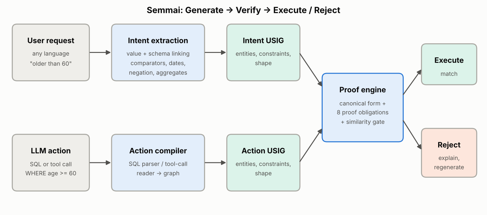
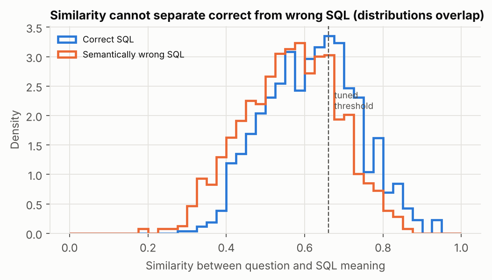
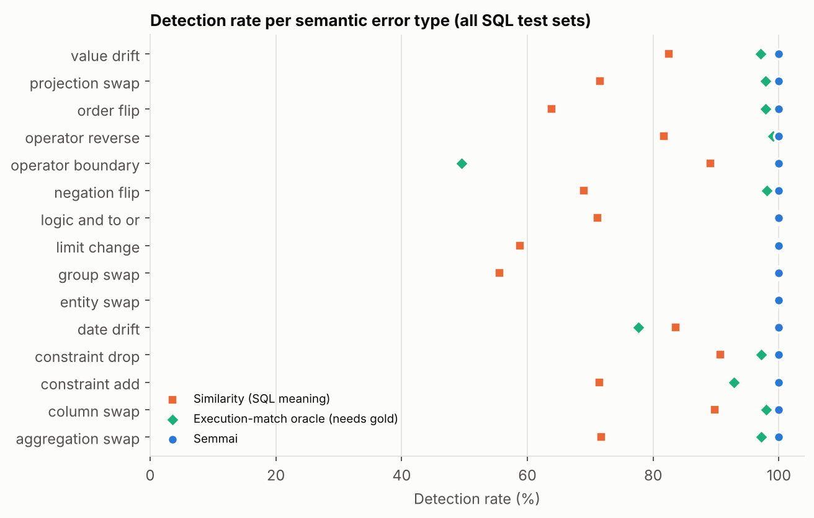
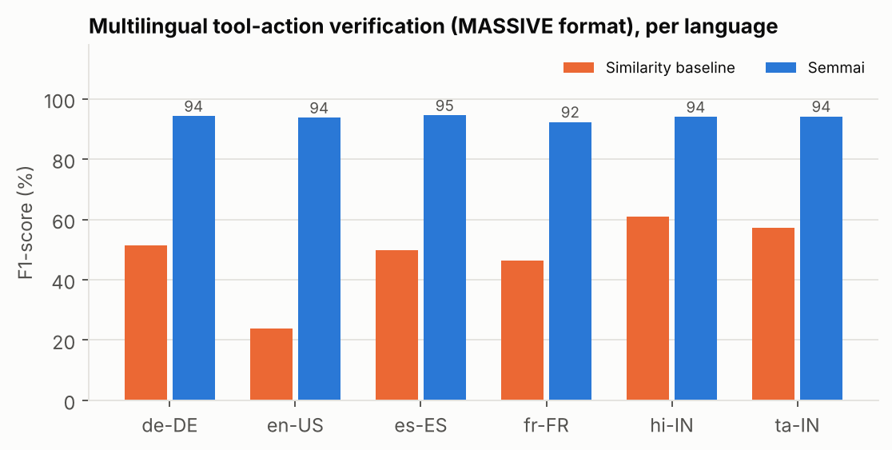

# Semmai (செம்மை): A Neuro-Symbolic Semantic Verification Layer for Tamil and Multilingual LLM Agents

**Project report** · Repository: <https://github.com/hannielvinu/Semmai>

---

## Abstract

Large Language Models (LLMs) are increasingly used as agents that translate natural-language
requests into executable database queries and tool/API calls. Existing safeguards validate
syntax, permissions and output formats, but they do not check whether the generated action
preserves the user's *meaning*: a query with `age >= 60` for "older than 60", or a purchase
threshold of ₹5,000 instead of ₹10,000, is syntactically valid, permitted and executable - and
wrong. We present **Semmai**, a verification layer placed between generation and execution.
Semmai compiles both the user request and the generated action into a language-independent
**Universal Semantic Intent Graph (USIG)**, brings both graphs into a canonical form, and checks
eight proof obligations (entities, constraints, operators, values, logic, aggregation,
projection/grouping, ranking) before allowing execution; a neural similarity signal is available
as a secondary gate. For multilingual tool calls, a multilingual intent model plus slot-grounding
checks verify the action against the utterance.

On a BIRD-format text-to-SQL verification benchmark (2,584 candidate queries over 5 databases,
15 semantic error types, 9 meaning-preserving rewrite types), Semmai reaches **97.0% accuracy,
97.5% F1 and 0.0% false acceptance on a blind test set** written before the system was run on it
(100% on the generated and hand-written sets), compared with 0% F1 for syntax/permission checks
and 72% F1 for semantic similarity. It also outperforms an execution-match oracle that has access
to the correct answer, because 6-8% of semantic errors return identical rows on the current data.
On a MASSIVE-format multilingual tool-call benchmark in six languages (English, Tamil, Hindi,
French, Spanish, German), Semmai reaches **93.9% accuracy and 93.8% F1** versus 49.9% F1 for
similarity. In an end-to-end agent simulation with a 20% LLM error rate, Semmai with
regeneration raises correct answers from 80.8% to 97.6% and reduces silently wrong answers from
19.2% to 0%. Verification takes about 2.5 ms per query on a laptop CPU.

**Tamil.** Because the motivating use case is Tamil users talking to databases through an LLM, Semmai
includes a Tamil semantic parser that reads Tamil directly (case suffixes, sandhi, postposition
comparators such as *2022க்குப் பிறகு* "after 2022", negation such as *தவிர* "except", Tamil number words
and *லட்சம்*) and a Tamil chatbot that shows every step of the pipeline. On a Tamil blind test set
frozen before the parser was written, Semmai recovered the exact meaning of 98% of questions on the
first run; it rejected every one of 223 realistic translation mistakes ("after" → "from", dropped
"except", ...), 96% of which would otherwise have silently returned a wrong answer; and in an
end-to-end simulation where the AI errs 20% of the time, wrong answers shown to the user fell from
18.3% to 0%.

---

## 1. Problem

An LLM agent maps a request *q* to an action *a* (SQL query, API call) that is then executed.
Current pipelines check that *a* is:

* **syntactically valid** (it parses / compiles),
* **permitted** (it only touches allowed tables / tools),
* **well-formed** (JSON schema, argument types).

None of these checks asks the question that matters: **does *a* mean what *q* asked for?**

| Request | Generated action | Valid? | Means the same? |
|---|---|---|---|
| Show patients **older than 60** | `SELECT name FROM patients WHERE age >= 60` | yes | **no** - includes age 60 |
| Customers from Chennai with purchases **above ₹10,000** | `... WHERE city='Chennai' AND amount > 5000` | yes | **no** - value drift |
| All students **except** Mechanical | `... WHERE department = 'Mechanical'` | yes | **no** - negation lost |
| **Average** fare of Air India flights | `SELECT MAX(price) ...` | yes | **no** - wrong aggregate |
| Turn **off** the kitchen lights (any language) | `iot_hue_lighton(house_place="kitchen")` | yes | **no** - wrong action |

These errors are dangerous precisely because they are silent: the action runs, returns a
plausible-looking result, and nobody notices. In healthcare, finance or government settings a
one-character operator change can alter a report, a payment batch or an eligibility list.

**Goal.** Build a model-agnostic, multilingual verification layer that, *before execution*,
decides whether an action preserves the user's intent - with high detection of wrong actions
(low false acceptance), few false alarms on correct actions, and a human-readable explanation.

Project targets (from the proposal): verification accuracy ≥ 90%, F1 ≥ 90%, false acceptance
rate ≤ 5%.

## 2. Related work

* **Text-to-SQL benchmarks.** Spider (Yu et al., 2018) and BIRD (Li et al., 2023) evaluate
  generation by exact match or *execution accuracy* - comparing results with a gold query.
  Execution comparison on one database is known to accept wrong queries that happen to return
  the same rows (Zhong et al., 2020, "test-suite accuracy"); at run time no gold query exists at all.
* **Guardrails for LLM applications** such as NeMo Guardrails (Rebedea et al., 2023) and
  Llama Guard (Inan et al., 2023) focus on topical, safety and policy constraints of the
  conversation, not on whether a generated query is faithful to the request.
* **Self-correction.** Self-debugging approaches (Chen et al., 2023) let models revise code using
  execution feedback; Semmai supplies a *semantic* error signal (with explanations) that such a
  regeneration loop can use.
* **Semantic similarity.** Sentence-BERT (Reimers & Gurevych, 2019) gives sentence embeddings for
  similarity; we show that similarity alone cannot separate correct from subtly wrong actions,
  because the differences that matter (an operator, a number, a "not") barely move a similarity score.
* **Multilingual NLU.** MASSIVE (FitzGerald et al., 2023) provides intent + slot annotations
  across 51 languages, the format we use for tool-call verification.
* **Code LLMs.** Qwen2.5-Coder (Hui et al., 2024) is the default real generator supported by the
  pipeline.

The gap Semmai addresses: there is no widely used, general framework that verifies - before
execution, without a gold answer, across tools and languages - that an LLM-generated action
preserves the user's intent.

## 3. Method



### 3.1 Universal Semantic Intent Graph (USIG)

A USIG is the meaning of a request or an action, independent of language and syntax:

| Node | Example (for "Customers from Chennai with purchases above ₹10,000") |
|---|---|
| entities | `customers`, `orders` (primary: `customers`) |
| projections | `customers.name` |
| constraints | `customers.city = 'Chennai'`, `orders.amount > 10000` |
| joins | `customers.customer_id = orders.customer_id` |
| group_by / order_by / limit / distinct | - |

**Canonical form.** Before comparison both graphs are canonicalised so that equivalent
surface forms coincide: on integer columns `x >= 61` becomes `x > 60`; on dates
`d <= '2020-12-31'` becomes `d < '2021-01-01'`; `BETWEEN a AND b` becomes two bounds;
`x IN ('a')` becomes `x = 'a'`; `strftime('%Y', d) = '2023'` becomes a date range;
`col = 'A' OR col = 'B'` becomes `col IN ('A','B')`.

### 3.2 Intent extraction (request → USIG)

A schema-grounded semantic parser that needs no training data:

1. **Normalisation** - contractions ("doesn't exceed" → "does not exceed"), number words, currency
   (₹, Rs., INR, rupees), Indian number formats (`1,00,000`) and scale words (lakh, crore, k).
2. **Value linking** - every categorical database value is indexed (as in BIRD-style value
   retrieval); mentions are matched exactly (multi-word: "Air India", "Premium Economy") or by
   stem-prefix ("cardiologist" → `Cardiology`). When a value occurs in several columns (a city is
   both `origin` and `destination`), cue words decide ("**from** Chennai **to** Delhi").
3. **Entity and column linking** - table nouns and column synonyms (from schema metadata, or
   derived automatically from column names) with stemmed matching ("departs" ≈ "departing").
4. **Temporal expressions** - ISO dates, "15 March 2023", "March 2024", bare years; operators
   *after / since / from … onwards / before / on or before / in / during* map to precise ranges
   ("after 2020" → `> 2020-12-31`, "in March 2024" → `[2024-03-01, 2024-03-31]`).
5. **Numeric constraints** - 60+ comparator phrases including suffix forms ("60 and above",
   "90 marks or more"), negated forms ("not more than", "doesn't exceed") and ranges
   ("between 5000 and 20000", "from 5000 to 8000"). Each number is attached to the most plausible
   column by a score combining synonym proximity, comparator hints ("older than" → age, "cheaper
   than" → price), currency, units ("2 hours" → 120 for a minutes column) and whether the value
   lies inside the column's range in the database.
6. **Negation scope** - "not", "except", "other than", "outside", "excluding" within the clause
   flip `=`/`IN` to `!=`/`NOT IN`.
7. **Shape** - COUNT / AVG / SUM / MAX / MIN, superlatives vs. aggregates ("Which doctor has the
   highest fee" → ORDER BY … LIMIT 1, but "What is the highest fee" → MAX), top-k ("the 3 cheapest
   books"), GROUP BY ("per department"), ORDER BY ("sorted by price descending").

### 3.3 Action semantic extraction (SQL → USIG)

A recursive-descent compiler for the SELECT subset produced by text-to-SQL models: projections,
aggregates, aliases, `JOIN … ON` and comma joins, `WHERE` with `AND/OR/NOT`, `BETWEEN`, `IN`,
`LIKE`, `IS NULL`, literal-on-the-left comparisons, `strftime`, `GROUP BY`, `HAVING`,
`ORDER BY` (by alias or position) and `LIMIT/OFFSET`. Anything outside the subset (sub-queries,
`UNION`, `CASE`) raises *UnsupportedSQL* and the action is **rejected as UNVERIFIABLE**
(fail-closed: Semmai never certifies what it cannot analyse).

### 3.4 Semantic proof engine

The two canonical graphs are compared obligation by obligation; every violation becomes a finding
with a severity and an explanation.

| Obligation | Findings (critical unless noted) |
|---|---|
| Entity | `WRONG_ENTITY`; `EXTRA_JOIN` (warning) |
| Constraints | `CONSTRAINT_MISSING`, `OPERATOR_MISMATCH` (incl. boundary shifts), `VALUE_DRIFT`, `NEGATION_FLIP`, `COLUMN_MISMATCH`, `CONSTRAINT_CHANGED` |
| No extras | `CONSTRAINT_EXTRA` |
| Logic | `LOGIC_MISMATCH` (AND turned into OR) |
| Aggregation | `AGGREGATION_MISMATCH` (`COUNT(*)` ≡ `COUNT(pk)`) |
| Projection / grouping | `PROJECTION_MISMATCH`, `PROJECTION_MISSING`, `GROUP_MISMATCH` |
| Ranking | `ORDER_MISMATCH`, `ORDER_DIRECTION`, `ORDER_EXTRA`, `LIMIT_MISMATCH` |

Constraint matching is done in three passes: exact matches; same column with something changed
(classified as negation flip, operator/boundary change, value drift, or general change); and
finally constraints that moved to another column or are missing. Remaining action constraints are
extras. Example output:

```
Decision : REJECT
SQL means: list name of patients where age at least 60
[critical] OPERATOR_MISMATCH: boundary/operator changed: expected 'age more than 60', got 'age at least 60'
```

### 3.5 Neural similarity

`similarity.py` scores the request against a verbalisation of the action ("list name of patients
where age at least 60") with Sentence-BERT (`paraphrase-multilingual-MiniLM-L12-v2`) when
available, otherwise with a character n-gram (2-4) vector model that needs no download. In the
full system it acts as an optional gate on actions the proof engine accepted; the gate threshold
is tuned on the development split. It is also evaluated alone as the "semantic similarity"
baseline from the original proposal.

### 3.6 Multilingual tool-call verification

For tool actions `{"intent": …, "slots": {…}}` (MASSIVE format), `ToolVerifier` checks:

* **Intent** - a multilingual intent model (character n-gram TF-IDF + logistic regression trained
  on all six languages at once) must not contradict the proposed intent (rejected if the proposal
  is not the top intent and its probability is below a threshold tuned by cross-validation on
  training data).
* **Grounding** - every slot value must occur in the utterance (catches value drift and
  hallucinated arguments: "காலை 7 மணி" vs "காலை 8 மணி").
* **Slot schema** - slot types must be valid for the intent.
* **Coverage** - slot values found in the utterance by a gazetteer learned from training
  annotations must not be dropped; and every **number** in the request must be carried by some
  slot (numeric-coverage rule).
* **Type** - a known value must sit in a slot of its own type (a time is not a date).

### 3.7 Agent pipeline

`pipeline.py` implements *Generate → Verify → Execute / Reject*, optionally regenerating up to *k*
times after a rejection. Generators are pluggable: `OllamaGenerator` (Qwen2.5-Coder via a local
Ollama server) and `SimulatedLLM` (reproducible error injection, used in the experiments).

### 3.8 Tamil semantic parser and chat pipeline

Tamil is agglutinative and verb-final: meaning words carry case suffixes and comparison words come
*after* the number (*2022க்குப் பிறகு சேர்ந்த ஊழியர்களைக் காட்டு* = "2022-DAT after joined employees-ACC show").
`semmai/tamil.py` handles this without any training data:

1. **Tokenisation**: numbers are split from glued suffixes (*2022க்கு* → 2022 + க்கு), sandhi consonants
   are dropped (*ஊழியர்களைக்* → ஊழியர்களை), and Tamil number words and scales (*ஐம்பது ஆயிரம்*, *1 லட்சம்*) are read.
2. **Suffix-aware lexicon matching**: a word matches a lexicon stem if the remainder is a plausible
   Tamil suffix (*சென்னையைச்* = சென்னை + யை; *சம்பளத்தின்படி* = சம்பளம் + த்தின்படி; *கோயம்புத்தூரை*), while
   look-alikes are rejected (*ஆண்* "male" vs *ஆண்டு* "year"). Multi-word entries (*குழுத் தலைவர்*,
   *திருப்பி அனுப்பப்பட்ட*) are matched longest-first.
3. **Concept grammar**: the comparator after a number decides the operator (*மேல்* >, *குறைவான* <,
   *அல்லது அதற்கு மேல்* ≥, *பிறகு* after, *முதல்* from/since, *வரை* until, *இடையில்* between). Negation words after a
   value (*தவிர*, *அல்லாத*, *இல்லாத*) negate it. Superlatives (*அதிக சம்பளம் வாங்கும் 5*) become ranking + limit,
   *ஒவ்வொரு* / *வாரியாக* become grouping, and *நீக்கு* becomes a DELETE.
4. **Meaning frame → English → USIG**: the frame is rendered as an English sentence (this doubles as the
   built-in translator) and parsed into the USIG by the English intent extractor.

The chat pipeline (`semmai/chat.py`) runs two independent paths for every Tamil question. On the
**AI path**, a translator (built in, or IndicTrans2) produces English and an LLM (built in, Qwen2.5-Coder
via Ollama, or any OpenAI-compatible API) writes SQL. On the **Semmai path**, the Tamil parser builds the
user-intent graph. The proof engine compares the two. A mismatch blocks execution; the AI is asked
again with the findings as feedback (up to three attempts), and if it still fails, Semmai compiles the
SQL directly from the verified intent graph ("repair"). DELETE statements only ever run as a dry run.
A **final check** compares the *output* intent with the *user* intent in three ways: the executed SQL's
graph against the request graph; the answer against an answer computed independently from the intent
graph; and the answer's shape (one number for a count, at most *k* rows for top-*k*).

To demonstrate and measure this, the AI translator can be told to make realistic mistakes. These are
implemented as edits to the meaning frame: "after" → "from", "before" → "until", dropped "except",
lost negation, "more than" → "at least", changed numbers or years, dropped filters,
highest ↔ lowest, a changed top-*k* and average → maximum.

## 4. Datasets

The official BIRD and MASSIVE downloads were not reachable from the environment in which the
project was built, so both benchmarks were **constructed in the official formats**; the scripts
accept the official files unchanged (`data/README.md`).

**BIRD-format text-to-SQL.** Five SQLite databases (hospital, retail, university, finance,
travel; 13 tables, 8,907 rows, deterministic synthetic data with Indian context: cities, ₹
amounts, airlines) and three question sets:

| Set | Questions | How written | Use |
|---|---|---|---|
| Generated | 379 | many paraphrase frames, 11 question types, gold SQL | 30% dev (threshold tuning) / 70% test |
| Hand-written | 60 | free-form, by hand | development check |
| **Blind** | 80 | free-form, by hand, **committed to git before the system was run on them**; no changes afterwards | final test |

**Verification benchmark.** For each question: the gold SQL and one meaning-preserving rewrite
(label *correct*) and up to three semantic mutations (label *mismatch*). The 15 mutation types
implement the error taxonomy of the proposal (wrong entity, wrong operator, missing / extra
constraint, wrong values or dates) plus aggregation, ranking, logic, projection and grouping
errors. Every rewrite is checked by execution to return exactly the gold rows. Totals: 2,584
pairs (1,038 correct / 1,546 mismatched).

**MASSIVE-format multilingual set.** 1,595 utterances in en-US, ta-IN, hi-IN, fr-FR, es-ES, de-DE
across 12 intents and 11 slot types. Training and test utterances come from **different sentence
templates**, and 259 test utterances contain slot values never seen in training. Each test
utterance yields 4 candidate tool calls (gold, re-serialised gold, 2 mutations from intent swap,
slot value drift, slot drop, slot addition, slot type swap): 2,812 pairs.

## 5. Experimental setup

**Metrics** (positive class = mismatch, i.e. the action must be rejected): accuracy, precision,
recall (= detection rate), F1, **false acceptance rate** (FAR: wrong actions that would be
executed - the safety metric) and **false rejection rate** (FRR: correct actions blocked - the
usability cost).

**Baselines.**

| Baseline | Decision rule |
|---|---|
| Syntax + permission | SQLite compiles the query (`EXPLAIN`) and it uses only known tables - the status quo |
| Execution sanity | the query runs and returns at least one non-empty row |
| Similarity (SQL text) | similarity(question, raw SQL) ≥ *t* |
| Similarity (SQL meaning) | similarity(question, verbalised SQL) ≥ *t* - the proposal's similarity design |
| Execution-match oracle | result equals the **gold** query's result - not deployable (needs the answer), shown as a reference |

All thresholds are tuned on the development split only (balanced accuracy); the hand-written and
blind sets are never used for tuning.

## 6. Results

### 6.1 SQL verification

| Method | Generated test (1,319) Acc / F1 / FAR | Hand-written (300) Acc / F1 / FAR | **Blind (398)** Acc / F1 / FAR / FRR |
|---|---|---|---|
| Syntax + permission | 40.2 / 0.0 / 100.0 | 40.0 / 0.0 / 100.0 | 40.2 / 0.0 / 100.0 / 0.0 |
| Execution sanity | 41.6 / 6.1 / 96.8 | 42.3 / 9.4 / 95.0 | 44.2 / 15.3 / 91.6 / 2.5 |
| Similarity (SQL text) | 57.5 / 59.4 / 48.2 | 59.0 / 64.8 / 37.2 | 55.3 / 57.4 / 49.6 / 37.5 |
| Similarity (SQL meaning) | 61.9 / 70.0 / 25.9 | 60.0 / 71.7 / 15.6 | 61.1 / 72.2 / 15.5 / 73.8 |
| **Semmai** | **100.0 / 100.0 / 0.0** | **100.0 / 100.0 / 0.0** | **97.0 / 97.5 / 0.0 / 7.5** |
| Execution-match oracle* | 95.3 / 95.9 / 7.9 | 95.3 / 96.0 / 7.8 | 96.2 / 96.7 / 6.3 / 0.0 |

(\* needs the gold answer; all values in %.)


**Observations.**

1. **Syntax and permission checks catch nothing**: every mutated query is valid SQL over permitted
   tables. "Returns rows" catches almost nothing either.
2. **Similarity is not enough.** The ROC-AUC of the similarity score for separating correct from
   wrong queries is only 0.60-0.63 (0.5 = chance): changing `>` to `>=` or 10000 to 5000 barely
   moves a similarity score, while harmless rewrites (aliases, `BETWEEN`) move it a lot. The
   distributions overlap almost completely:

   

3. **Semmai detects every error type.** On all test sets combined, Semmai detects 100% of each of
   the 15 mutation types and accepts 96-100% of each rewrite type:

   

4. **Semmai beats execution comparison with the gold answer.** 91 of the 1,207 test mutations
   (7.5%) return exactly the same rows as the correct query on the current data - e.g. half of
   all `>` ↔ `>=` boundary errors, because no row sits exactly on the boundary. Execution-based
   checking can never see these; a semantic proof does. These errors would surface later, when
   the data changes.
5. **The similarity gate adds nothing here.** The development-tuned gate threshold is 0, i.e. the
   proof engine alone is best on this benchmark (ablation: "proof only" = "proof + similarity").
   Similarity remains useful as a fallback signal for actions outside the symbolic coverage.
6. **Speed.** Mean verification time 2.5 ms (median 2.0 ms, 95th percentile 5.7 ms) on a laptop
   CPU - negligible next to LLM generation.

### 6.2 Multilingual tool-call verification

| Method | Accuracy | Precision | Recall | F1 | FAR ↓ | FRR ↓ |
|---|---|---|---|---|---|---|
| Schema validation | 50.0 | 0.0 | 0.0 | 0.0 | 100.0 | 0.0 |
| Similarity (utterance vs call) | 58.3 | 62.4 | 41.5 | 49.9 | 58.5 | 25.0 |
| Semmai: intent check only | 57.1 | 80.9 | 18.7 | 30.4 | 81.3 | 4.4 |
| Semmai: slot checks only | 95.0 | 100.0 | 89.9 | 94.7 | 10.1 | 0.0 |
| Semmai without numeric-coverage rule | 93.4 | 95.4 | 91.3 | 93.3 | 8.7 | 4.4 |
| **Semmai (full)** | **93.9** | **95.4** | **92.2** | **93.8** | **7.8** | **4.4** |

| Locale | Intent model accuracy | Semmai accuracy | Semmai F1 | FAR | Similarity F1 |
|---|---|---|---|---|---|
| English (en-US) | 82.4 | 93.8 | 93.7 | 7.6 | 23.7 |
| Tamil (ta-IN) | 75.7 | 94.3 | 94.2 | 8.7 | 57.1 |
| Hindi (hi-IN) | 85.3 | 94.2 | 94.0 | 9.1 | 60.8 |
| French (fr-FR) | 75.9 | 92.2 | 92.3 | 6.9 | 46.4 |
| Spanish (es-ES) | 89.7 | 94.6 | 94.5 | 7.3 | 49.7 |
| German (de-DE) | 84.3 | 94.3 | 94.3 | 7.0 | 51.4 |



Performance is consistent across languages, including the Indian languages with non-Latin
scripts, because grounding and coverage checks work on characters rather than on English words.
Slot value drift, added slots and slot type swaps are detected 96-100% of the time; intent swaps
83%, dropped slots 83%.

### 6.3 End-to-end agent

Questions from the generated test and blind sets; the simulated LLM makes one realistic semantic
error with probability *p* (3 seeds, 1,035 runs per error rate).

| LLM error rate | Pipeline | Correct answers | Wrong answers executed | No answer |
|---|---|---|---|---|
| 20% | Generate → Execute | 80.8% | **19.2%** | 0.0% |
| 20% | Generate → Verify → Execute/Reject | 79.5% | **0.0%** | 20.5% |
| 20% | … + regenerate (≤ 3 attempts) | **97.6%** | **0.0%** | 2.4% |
| 40% | Generate → Execute | 62.7% | 37.3% | 0.0% |
| 40% | … + regenerate (≤ 3 attempts) | **92.4%** | 0.2% | 7.4% |


Rejection alone turns *silent wrong answers* into *explicit refusals*; adding regeneration turns
most refusals back into correct answers.

### 6.4 Tamil

**Data.** An HR database built from the project story (600 employees, 6 departments, with joining
dates such that "after 2022" returns 170 people but "from 2022" returns 234), plus the hospital,
retail and university databases. There are 126 Tamil questions with gold SQL: 48 + 28 for
development (the second batch deliberately uses mixed Tamil-English, number words, ₹ and a suffix
written as a separate word) and **50 blind questions**, committed to git before any parser code
existed (`git log data/tamil/blind_test.json`).

| Measure | Result |
|---|---|
| Exact meaning, development sets | 100% (48/48), 100% (28/28) |
| Exact meaning, **blind set, first run** | **98.0% (49/50)** |
| Verification of SQL against Tamil requests, blind set: accuracy / F1 / FAR / FRR | **100.0% / 100.0% / 0.0% / 0.0%** |
| ... syntax + permission check | 40.2% / 0.0% / 100.0% / 0.0% |
| ... similarity, Tamil question vs SQL meaning | 52.6% / 55.3% / 51.0% / 42.0% |
| ... similarity, English translation vs SQL meaning | 61.8% / 64.2% / 43.0% / 31.0% |
| Realistic translation mistakes caught | **223/223 (100%)**; 214 of them (96%) would have silently changed the answer |
| End to end, AI wrong 20%: wrong answers shown | 18.3% → **0.0%** |
| End to end, AI wrong 40%: wrong answers shown | 37.0% → **0.0%** |


Comparing a Tamil sentence with SQL by surface similarity is close to chance, because the scripts
share almost no characters. Even after translation, similarity cannot tell "after 2022" from "from 2022".
The explicit meaning graph can.

*Caveats.* The end-to-end 0% assumes Semmai's own reading of the Tamil is right: when the Tamil parser
misreads a question, Semmai blocks correct SQL (a false rejection) or, after repair, answers the
misread question. On the blind set this happened for 1 of 50 questions on the first run. That one
pattern (a comparison suffix on a unit word: *7 ஆண்டுகளுக்குக் குறைவான*) was fixed afterwards in a separate
commit. The translation mistakes are simulated as edits to the meaning frame; IndicTrans2 and real
LLMs are supported but could not be run in the build environment, which had no access to model downloads.

### 6.5 Targets

| Target | SQL (blind) | Tamil SQL (blind) | Tools (6 languages) |
|---|---|---|---|
| Verification accuracy ≥ 90% | 97.0% ✅ | 100.0% ✅ | 93.9% ✅ |
| F1-score ≥ 90% | 97.5% ✅ | 100.0% ✅ | 93.8% ✅ |
| False acceptance rate ≤ 5% | 0.0% ✅ | 0.0% ✅ | 7.8% ✗ |

## 7. Error analysis

**SQL, blind set (7.5% false rejections).** Intent extraction was exactly right for 74 of 80 blind
questions (92.5%). Because the generated action is compared with the extracted intent, an
extraction error rejects the *correct* query (false rejection) but did not cause any false
acceptance. The six failures, left unfixed to keep the blind evaluation honest:

| Question | What went wrong | Fix direction |
|---|---|---|
| Appointments in December 2024 that were **no-shows** | plural "no-shows" not linked to value `No-show` | stem-match categorical values |
| Patients admitted **between 1 January 2023 and 30 June 2023** | "between" handled for numbers, not for two dates | date ranges with *between* |
| What is the most expensive **toy**? | singular "toy" not linked to `Toys` | stem-match categorical values |
| Total **debits** made via NetBanking | plural "debits" not linked to `Debit`; SUM therefore missed | stem-match values |
| Which flight to Delhi is **the most expensive**? | superlative at the end of the sentence with no column after it | look back for the entity |
| Savings accounts whose **holders are over 80** | "holders … over 80" means age; 80 was attached to balance (both ranges contain 80) | entity-attribute defaults (person → age) |

Four of six are morphological (plural/singular value linking) - a cheap fix for future work.

**Tools (FAR 7.8% > 5%).** The remaining accepted errors are (i) intent swaps the intent model
does not catch - it reaches 82% accuracy on held-out templates having seen only three templates per
intent and language - and (ii) dropped slots whose value was never seen in training and contains
no number (e.g. an unseen weekday), which the learned gazetteer cannot recognise. Training the
intent model on more varied data (e.g. the full MASSIVE training set of ~11,500 utterances per
language) and adding a multilingual slot tagger are the natural next steps. Note: the
numeric-coverage rule was added after inspecting misses on the tool test split; the table reports
the system with and without it (93.4% → 93.9% accuracy).

## 8. Limitations and threats to validity

* **Constructed datasets.** Both benchmarks were built in the official formats rather than taken
  from the official releases. The generated questions use phrasing frames whose vocabulary
  overlaps with the parser's lexicons, which is why Semmai is perfect on them; the blind set is the
  more realistic estimate, but it was written by the same author as the system.
* **Mutation-based errors.** Wrong queries are produced by injecting realistic single errors into
  gold SQL; real LLM errors can be more varied (several errors at once, unusual SQL). The Ollama
  backend (`run_pipeline_experiment.py --ollama qwen2.5-coder:7b`) allows measuring this with a real
  model.
* **SQL coverage.** Sub-queries, `CASE`, arithmetic expressions and window functions are outside
  the compiled subset; such actions are rejected as unverifiable rather than certified.
* **Language coverage of the SQL parser.** The natural-language side of SQL verification is
  English (with Indian number and currency conventions); multilingual coverage is demonstrated on
  tool calls.
* **Similarity backend.** Reported similarity numbers use the character n-gram fallback because
  the Sentence-BERT model could not be downloaded in the build environment; with
  `sentence-transformers` installed the scripts switch automatically.

## 9. Future work

1. Stemmed value linking and date *between* (fixes four of six blind failures).
2. Evaluate on the official BIRD dev set and MASSIVE 1.1 (scripts already support both).
3. Extend the SQL compiler with sub-queries and `CASE` via nested USIG nodes.
4. Multilingual SQL requests (Tamil/Hindi questions over the same databases) by adding
   language-specific lexicons or translate-then-verify.
5. Use Semmai's findings as structured feedback in the LLM's regeneration prompt.
6. Verify REST / GraphQL calls by compiling OpenAPI / GraphQL schemas into USIG entities.

## 10. Conclusion

Correct syntax does not mean correct intent. Across 2,584 SQL candidates, syntax and permission
checks accepted every semantically wrong query, and similarity scores were barely better than
chance at telling right from wrong. Semmai's explicit semantic graphs and proof obligations
detected every injected error type, with 97.5% F1 and no false acceptances on a blind test, and it
stayed effective across six languages for tool calls. Placed between an LLM and execution, it turns
silent wrong actions into explained rejections - and, with regeneration, into correct answers.

> *Before an AI agent acts, Semmai asks: does this action actually mean what the user asked for?*

## References

* Chen, X., Lin, M., Schärli, N., & Zhou, D. (2023). Teaching Large Language Models to Self-Debug. arXiv:2304.05128.
* FitzGerald, J., et al. (2023). MASSIVE: A 1M-Example Multilingual Natural Language Understanding Dataset with 51 Typologically-Diverse Languages. *ACL 2023*.
* Hui, B., et al. (2024). Qwen2.5-Coder Technical Report. arXiv:2409.12186.
* Inan, H., et al. (2023). Llama Guard: LLM-based Input-Output Safeguard for Human-AI Conversations. arXiv:2312.06674.
* Li, J., et al. (2023). Can LLM Already Serve as A Database Interface? A BIg Bench for Large-Scale Database Grounded Text-to-SQLs (BIRD). *NeurIPS 2023*.
* Rebedea, T., et al. (2023). NeMo Guardrails: A Toolkit for Controllable and Safe LLM Applications with Programmable Rails. *EMNLP 2023 (Demo)*.
* Reimers, N., & Gurevych, I. (2019). Sentence-BERT: Sentence Embeddings using Siamese BERT-Networks. *EMNLP-IJCNLP 2019*.
* Yu, T., et al. (2018). Spider: A Large-Scale Human-Labeled Dataset for Complex and Cross-Domain Semantic Parsing and Text-to-SQL Task. *EMNLP 2018*.
* Gala, J., et al. (2023). IndicTrans2: Towards High-Quality and Accessible Machine Translation Models for all 22 Scheduled Indian Languages. *Transactions on Machine Learning Research*.
* Zhong, R., Yu, T., & Klein, D. (2020). Semantic Evaluation for Text-to-SQL with Distilled Test Suites. *EMNLP 2020*.

## Appendix: reproducing the results

```bash
pip install -r requirements.txt
./run_all.sh              # rebuilds data, runs all evaluations, figures and tests (~1 minute)
```

| Output | Produced by |
|---|---|
| `results/sql_results.md/.json`, `sql_predictions.csv` | `scripts/evaluate_sql.py` |
| `results/tools_results.md/.json`, `tools_predictions.csv` | `scripts/evaluate_tools.py` |
| `results/pipeline_results.md/.json` | `scripts/run_pipeline_experiment.py` |
| `results/figures/*.png` | `scripts/make_figures.py` |

All random processes use fixed seeds; re-running produces identical data and metrics (only the
latency measurements vary).

### Running the demo

The local demo needs only Python 3.9+ (standard library): double-click `start_demo.bat` on Windows,
or run `python app/server.py`, and open <http://localhost:8000> for the Tamil chatbot
(<http://localhost:8000/lab> for the verifier lab and results). The multilingual intent model is
exported to `models/intent_model.json` by `scripts/evaluate_tools.py` and evaluated in plain Python;
its decisions are identical to the scikit-learn model on all 2,812 benchmark tool calls.
